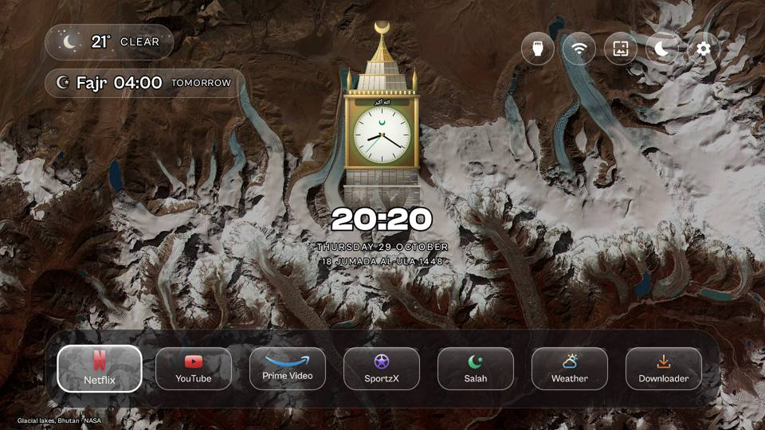
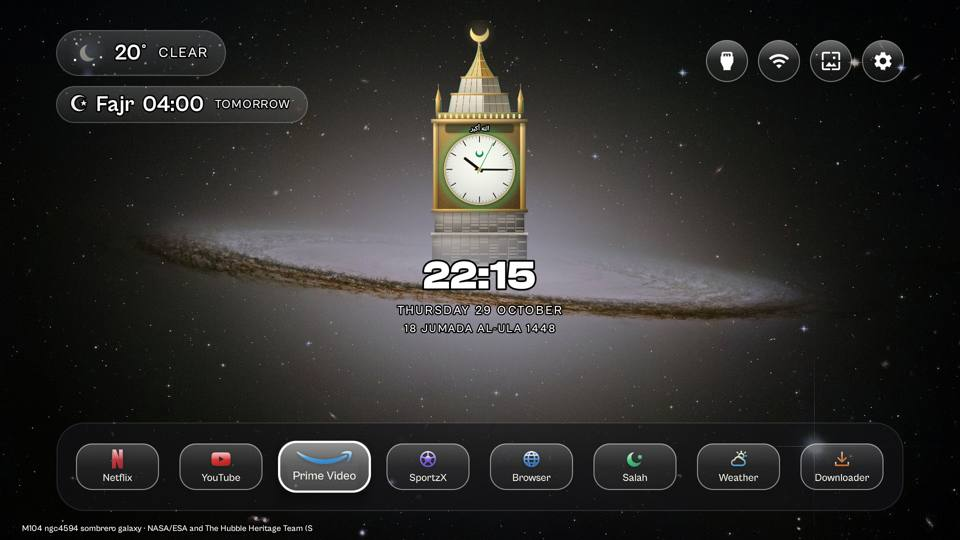
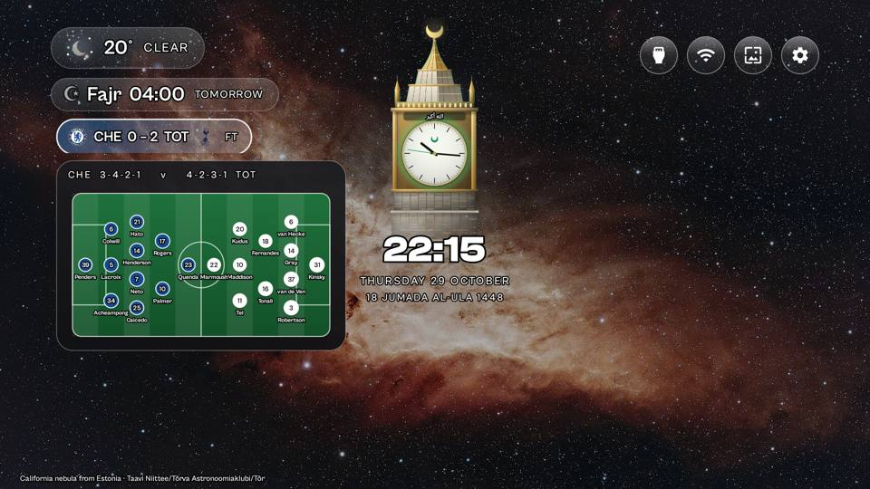
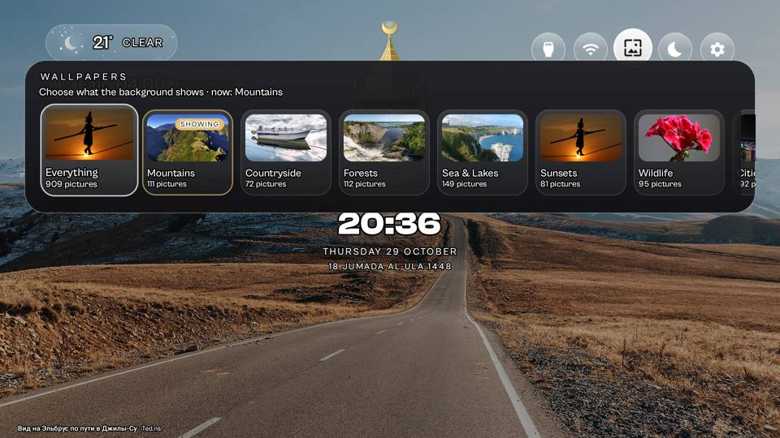
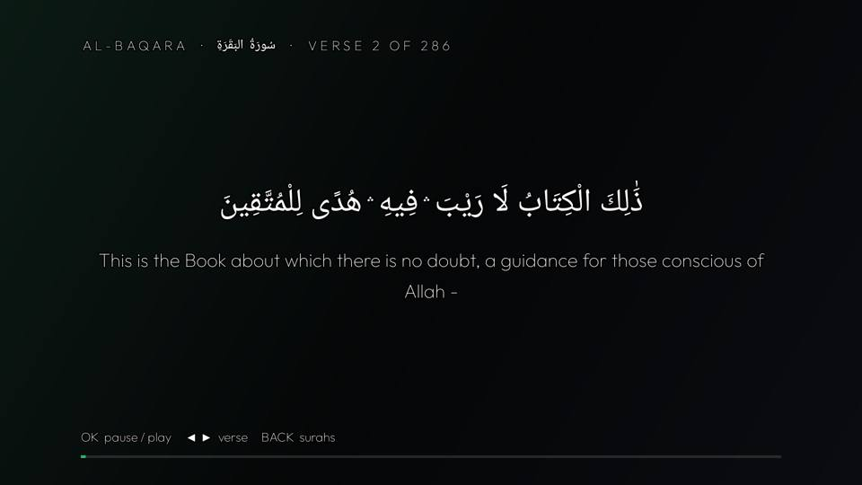

# Makkah Tower Home — a custom Android TV / Google TV home screen

A calm, cinematic home screen for Android TV and Google TV, with prayer times built in. It replaces the stock
launcher's ads and sponsored rows with one clean screen: a live Makkah Royal Clock Tower, prayer times with the
adhan, animated weather, world clocks, match-day scores and a rotating library of hundreds of free photos.

Built on the open-source [CleanYourTV](README-CleanYourTV.md) launcher (MIT).

## What it does

- **Makkah clock tower** in the centre: a rendered night view with a live dial, a glowing "الله أكبر" band and
  a green halo, plus the time, the date and the Hijri date, and the next Islamic day ("Day of Arafah in 9 days").
- **Prayer times** for your city (choose the calculation your community follows), or your mosque's own timetable
  if it is on MasjidBoardLive. The **Salah Times** app sounds an alert at each prayer, can wake the TV for Fajr and
  sends it back to standby, counts down to jamaah, and includes a **Qur'an player** (Sheikh Abdul Basit, verse by
  verse, Arabic and English).
- **Ramadan mode**: suhoor and iftar countdowns. **Jumu'ah** line on Fridays. **Eid** greeting.
- **Animated weather**: sun, rain, lightning and wind drawn live, severe-weather warnings, a 5-day forecast.
- **World clocks** that float out of the tower, each dial showing that city's sky right now.
- **Match day**: live scores for your teams, a banner when the line-ups are announced, and an animated pitch
  with both line-ups.
- **Wallpapers**: up to 300 freely licensed Wikimedia Commons featured photos in 8 categories, downloaded by the
  TV itself, rotating every minute, with a night mode after 19:00 and a small credit in the corner.
- **Idle screen**: Qur'an verses, hadith and morning/evening adhkar over a softened wallpaper.
- A minimal glass **dock** that slides away and comes back with the remote.

| | |
|---|---|
|  |  |
|  |  |

## Install (no computer needed)

1. On the TV, install **Downloader** (by AFTVnews) from the Play Store.
2. Open Downloader, type the code or the link from the release page, and install, in this order:
   **SalahTimes.apk**, **Weather.apk**, then **MakkahTowerHome.apk**. Allow "install unknown apps" for
   Downloader when the TV asks.
3. Open **Makkah Tower Home** from your apps. The setup asks for your city, how your prayer times are worked
   out, and your football teams. Wallpapers then start arriving.
4. Make it your home screen: in the TV's **Settings → Accessibility**, switch on **"Home button"** (the
   home screen's key helper). The Home button on the remote then opens it. Also allow Salah Times to
   "display over other apps" so the prayer banner can appear (Settings → Apps → Special app access).

Optional, with a computer: remove the stock launcher's ads and bloat over ADB with the tools from CleanYourTV
(see [README-CleanYourTV.md](README-CleanYourTV.md)).

## The adhan

For copyright reasons this edition ships with a gentle chime instead of an adhan recording. To use an adhan, put
your own recording at `addons/prayer-times/app/src/main/res/raw/adhan.mp3` (and `adhan_fajr.mp3` for Fajr)
and build Salah Times yourself (`build-release.ps1`).

## Build it yourself

Needs JDK 17 and the Android SDK (see CleanYourTV's docs). The Clash Display and Cabinet Grotesk fonts come from
[Fontshare](https://www.fontshare.com) (free, ITF Free Font License): put `clash_display_bold.otf`,
`cabinet_grotesk_bold.otf` and `cabinet_grotesk_medium.otf` in `launcher/app/src/main/res/font/`. Then run
`build-release.ps1`; the APKs land in `release/`.

## Credits

- [CleanYourTV](README-CleanYourTV.md) launcher by Gathin and contributors (MIT); Prayer Times add-on (majnioui),
  Weather add-on (sumyabazar1).
- Prayer times: [MasjidBoardLive](https://masjidboardlive.com) boards or [Aladhan](https://aladhan.com).
  Weather: [Open-Meteo](https://open-meteo.com). Qur'an text and audio: [alquran.cloud](https://alquran.cloud).
  Hadith: [fawazahmed0/hadith-api](https://github.com/fawazahmed0/hadith-api). Scores: ESPN's public scoreboard.
- Wallpapers: Wikimedia Commons featured pictures under free licences (CC0, public domain, CC BY, CC BY-SA); each
  photo's author is credited on screen, and the full list with licences is in
  `launcher/app/src/main/assets/wallpapers.tsv`.
- Fonts: Clash Display and Cabinet Grotesk (Indian Type Foundry, Fontshare), Unbounded, Manrope, Sora, Outfit
  (SIL Open Font License).

Not affiliated with Google, TCL or any streaming service. Licensed under the MIT License (see LICENSE).
